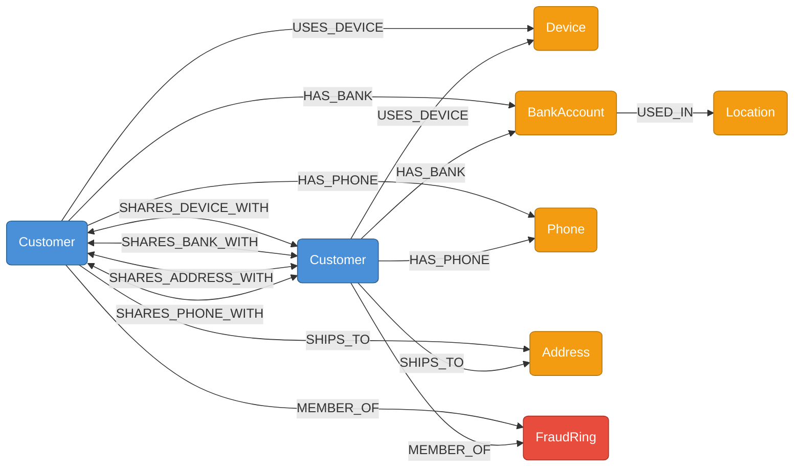

# Neo4j Graph Schema - Amazon Return Fraud Ring Detection System



---

## Node Properties

| Node Label | Key Properties | Notes |
|---|---|---|
| `Customer` | `customerID` (int), `name`, `email`, `phone`, `ipAddress`, `postcode` | `customerID` matches SQL Server `CustomerID` exactly |
| `Device` | `fingerprint` | Unique device fingerprint string |
| `BankAccount` | `bankRef` | Bank reference string - matches SQL `BankRef` on `[Order]` table |
| `Phone` | `phoneNumber` | Phone number string - matches SQL `Phone` on `Customer` table |
| `Address` | `postcode`, `city` | Shipping address postcode and city |
| `Location` | `city` | Geographic city where a card was used - used for skimming detection |
| `FraudRing` | `ringID`, `detectedAt`, `memberCount`, `sharedDevice`, `sharedBank`, `totalExposure` | Created when ring is confirmed |

---

## Relationship Summary

| Relationship | From → To | Created By | Purpose |
|---|---|---|---|
| `USES_DEVICE` | Customer → Device | `seed_data.py` | Links customer account to their device fingerprint |
| `HAS_BANK` | Customer → BankAccount | `seed_data.py` | Links customer account to their bank reference |
| `HAS_PHONE` | Customer → Phone | `seed_data.py` | Links customer account to their phone number |
| `SHIPS_TO` | Customer → Address | `seed_data.py` | Links customer account to their shipping address |
| `USED_IN` | BankAccount → Location | `seed_data.py` | Tracks cities where a card was used — enables skimming detection |
| `SHARES_DEVICE_WITH` | Customer ↔ Customer | `seed_data.py` | Direct link between accounts sharing the same device |
| `SHARES_BANK_WITH` | Customer ↔ Customer | `seed_data.py` | Direct link between accounts sharing the same bank reference |
| `SHARES_ADDRESS_WITH` | Customer ↔ Customer | `seed_data.py` | Direct link between accounts sharing the same delivery address |
| `SHARES_PHONE_WITH` | Customer ↔ Customer | `seed_data.py` | Direct link between accounts sharing the same phone number |
| `MEMBER_OF` | Customer → FraudRing | `seed_data.py` | Assigns a confirmed ring member to their FraudRing node |

---

## Constraints and Indexes

All constraints and indexes are created programmatically by `seed_data.py` using `IF NOT EXISTS` syntax - safe to re-run.

### Uniqueness Constraints (7)

| Constraint Name | Node Label | Property | Purpose |
|---|---|---|---|
| `customer_id` | Customer | `customerID` | Prevents duplicate customer nodes - bridges to SQL CustomerID |
| `device_fp` | Device | `fingerprint` | Prevents duplicate device nodes |
| `bank_ref` | BankAccount | `bankRef` | Prevents duplicate bank account nodes |
| `phone_num` | Phone | `phoneNumber` | Prevents duplicate phone nodes |
| `address_key` | Address | `postcode`, `city` | Prevents duplicate address nodes |
| `location_city` | Location | `city` | Prevents duplicate location nodes |
| `fraud_ring_id` | FraudRing | `ringID` | Ensures one FraudRing node per confirmed ring |

### Performance Indexes (6)

| Index Name | Node Label | Property | Fraud Detection Use |
|---|---|---|---|
| `customer_postcode` | Customer | `postcode` | Geographic clustering queries |
| `customer_ip` | Customer | `ipAddress` | Suspect eCommerce IP matching |
| `device_fingerprint` | Device | `fingerprint` | Core fraud ring device lookup |
| `bank_ref_idx` | BankAccount | `bankRef` | Fraud ring and skimming bank reference lookup |
| `phone_number` | Phone | `phoneNumber` | Duplicate phone detection |
| `location_city_idx` | Location | `city` | Card skimming geographic lookup |

---

## Four Fraud Patterns

### 1. Fraud Ring
Multiple `Customer` nodes share the same `Device` and `BankAccount` hub nodes.

```cypher
MATCH (c1:Customer)-[:USES_DEVICE]->(d:Device)<-[:USES_DEVICE]-(c2:Customer)
MATCH (c1)-[:HAS_BANK]->(b:BankAccount)<-[:HAS_BANK]-(c2)
WHERE c1.customerID < c2.customerID
RETURN c1.customerID, c2.customerID, d.fingerprint, b.bankRef
```

Seeded fraud rings:
- **Ring A** - CustomerIDs 1–5, device `fp_ring_alpha_a1b2`, bank `BARC-9921-GBP`, postcode `EC1A 1BB`
- **Ring B** - CustomerIDs 6–9, device `fp_ring_gamma_c3d4`, bank `BARC-3344-GBP`, postcode `E1 6RF`

---

### 2. Duplicate Phone
Two `Customer` nodes share the same `Phone` hub node.

```cypher
MATCH (c1:Customer)-[:HAS_PHONE]->(p:Phone)<-[:HAS_PHONE]-(c2:Customer)
WHERE c1.customerID < c2.customerID
RETURN c1.customerID, c2.customerID, p.phoneNumber
```

Seeded duplicate phone pairs:
- **Dup Phone A** - CustomerIDs 10 & 11, phone `07700900999`
- **Dup Phone B** - CustomerIDs 12 & 13, phone `07700901234`

---

### 3. Card Skimming
A `BankAccount` node has `USED_IN` edges to two or more `Location` nodes — same card used in geographically impossible locations within a short timeframe.

```cypher
MATCH (b:BankAccount)-[:USED_IN]->(loc:Location)
WITH b, collect(loc.city) AS cities
WHERE size(cities) > 1
RETURN b.bankRef, cities
```

Seeded skimming signals:
- **CustomerID 14** - card `BARC-7788-GBP` used in London at 09:00 and Edinburgh at 09:45 (45 min gap - impossible travel)
- **CustomerID 15** - card `BARC-5566-GBP` used in Manchester at 10:00 and Bristol at 11:00 (60 min gap - impossible travel)

---

### 4. Suspect eCommerce
Multiple `Customer` nodes share the same `Device` fingerprint and IP address - multiple accounts operated by the same person or group.

```cypher
MATCH (c:Customer)-[:USES_DEVICE]->(d:Device)
WITH d, collect(DISTINCT c.customerID) AS suspects
WHERE size(suspects) > 1
RETURN d.fingerprint, suspects
```

Seeded eCommerce groups:
- **eCommerce A** - CustomerIDs 16-18, device `fp_shared_ecom_a`, IP `85.10.20.30`
- **eCommerce B** - CustomerIDs 19-21, device `fp_shared_ecom_b`, IP `91.22.33.44`

---

### Shortest Path — Scenario 3
Find the shortest chain of connections between two flagged customers across any shared attribute node.

```cypher
MATCH path = shortestPath(
    (c1:Customer {customerID: $id1})-[*..10]-(c2:Customer {customerID: $id2})
)
RETURN [n IN nodes(path) |
    CASE
        WHEN n:Customer    THEN 'Customer#'  + toString(n.customerID)
        WHEN n:Device      THEN 'Device:'    + n.fingerprint
        WHEN n:BankAccount THEN 'Bank:'      + n.bankRef
        WHEN n:Phone       THEN 'Phone:'     + n.phoneNumber
        WHEN n:Address     THEN 'Address:'   + n.postcode
        WHEN n:Location    THEN 'Location:'  + n.city
        WHEN n:FraudRing   THEN 'Ring:'      + n.ringID
        ELSE 'Node'
    END
] AS path_nodes,
length(path) AS hops
```

---

## Instance Details

| Property | Value |
|---|---|
| Platform | Neo4j AuraDB (cloud) |
| Instance Name | AmazonFraudDB |
| Connection Protocol | Bolt+SSC (encrypted) |
| URI Format | `neo4j+ssc://xxxxxxxx.databases.neo4j.io:7687` |
| Seeding Script | `seed_data.py` |
| Customer ID Type | Integer - matches SQL Server `CustomerID` exactly |
