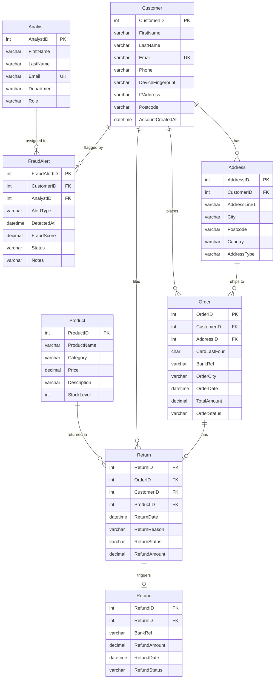

# Entity Relationship Diagram — Amazon Return Fraud Ring Detection System
## BEMM459 — University of Exeter

## Fraud Signal Columns

| Column | Table | Fraud Pattern |
|---|---|---|
| `Phone` | Customer | Duplicate Phone |
| `DeviceFingerprint` | Customer | Suspect eCommerce / Fraud Ring |
| `IPAddress` | Customer | Suspect eCommerce |
| `Postcode` | Customer, Address | Fraud Ring geographic clustering |
| `BankRef` | Order, Refund | Fraud Ring, Skimming |
| `CardLastFour` | Order | Skimming |
| `OrderCity` | Order | Skimming (impossible travel) |
